# MAD Club · NHCE

**The website of the Mobile App Development Club at New Horizon College of Engineering, Bengaluru.**
*Don't just use the future. Build it.*

The site builds itself in front of you. Eleven builders, one for each role on the club's core team, assemble every page, construct a working phone out of particles, project the team as holograms and run the club's events as interactive stories. It is a static site with no build step. Every word, event, photo and team member comes from editable JSON in `content/`.

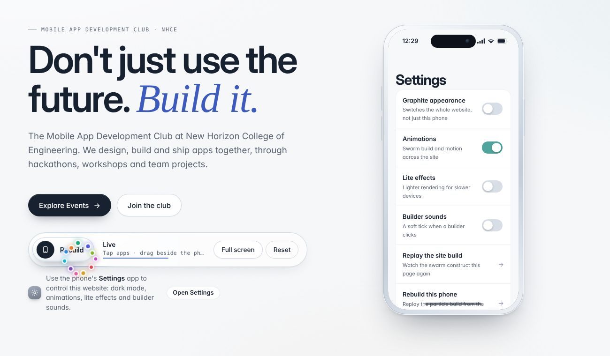

---

## Contents

- [The builders](#the-builders)
- [The phone](#the-phone)
- [The team, as holograms](#the-team-as-holograms)
- [Events](#events)
- [Gallery](#gallery)
- [Details](#details)
- [How to see each feature](#how-to-see-each-feature)
- [Editing the content](#editing-the-content)
- [Running and deploying](#running-and-deploying)
- [Code layout](#code-layout)

---

## The builders

### Eleven builders, one per role

The crew is the club's core team. Each builder carries its role's short tag and its own colour:

| Tag | Role | Tier | Colour |
|---|---|---|---|
| `PRES` | President | Core | Gold |
| `VP` | Vice President | Core | Rose |
| `SEC` | Secretary | Core | Satin violet |
| `TRES` | Treasurer | Core | Cyan |
| `PGM CH` / `PGM VC` | Program Committee Chair / Vice Chair | Committee | Azure / Tangerine |
| `PRJ CH` / `PRJ VC` | Project Committee Chair / Vice Chair | Committee | Emerald / Indigo |
| `MKT CH` / `MKT VC` | Marketing Committee Chair / Vice Chair | Committee | Lime / Magenta |
| `REV CH` | Review Committee Chair | Committee | Crimson |

### Assigning builders

On a first visit the screen starts blank. Eleven glass nodes light up clockwise as each builder is assigned. The club logo then powers them through a circuit board: traces spread evenly from the logo's outline, a glow flows along them, and they end in tapering branches.

<p>
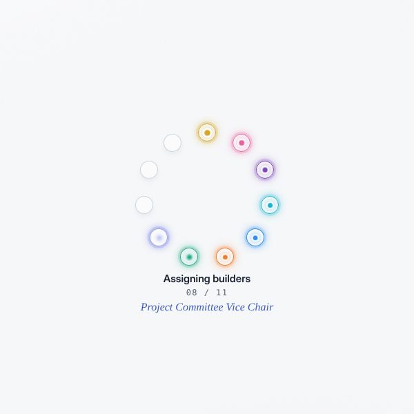
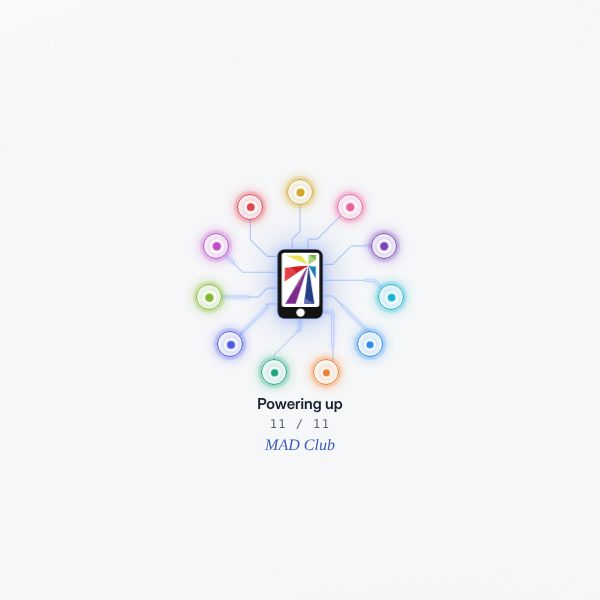
</p>

Once powered, the builders come alive and orbit the visitor's cursor, with a little life of their own, until there is work to do.

### Committees lay out, the core approves

Every page is built the way the club runs: committee builders select each part of the page and lay down its skeleton. As each part is ready, a core builder comes over, stamps it approved with its role (`✓ PRES`, `✓ SEC`) and creates the real content. Selections are drawn in the colour of the builder doing the work. At least three or four builders join every job, so even small changes look like a team at work.

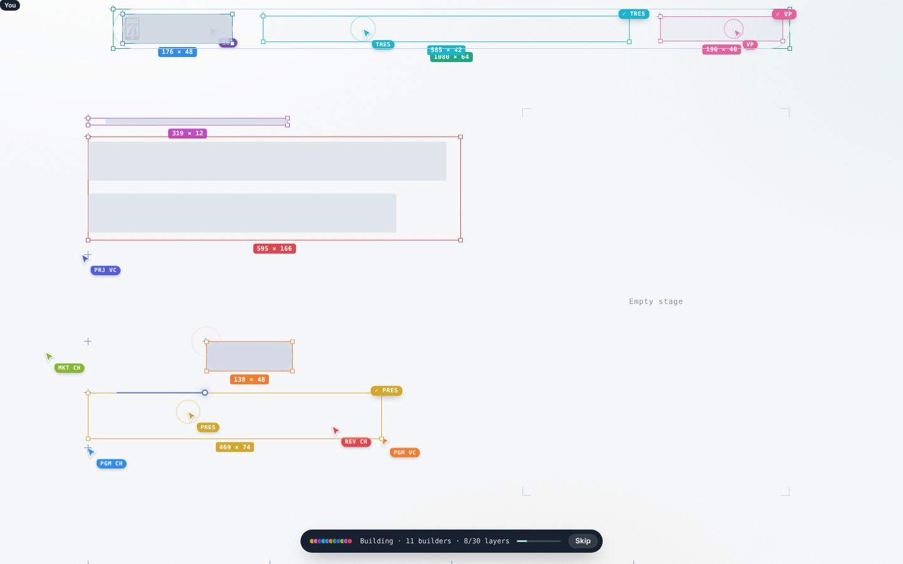

Everything that scrolls into view is built the same way: sections, cards, posters, the phone's screens and filtered results.

### Builder log

**Ctrl K → Builder log** opens a live log of who laid out and who approved each part of the page, tagged by role.

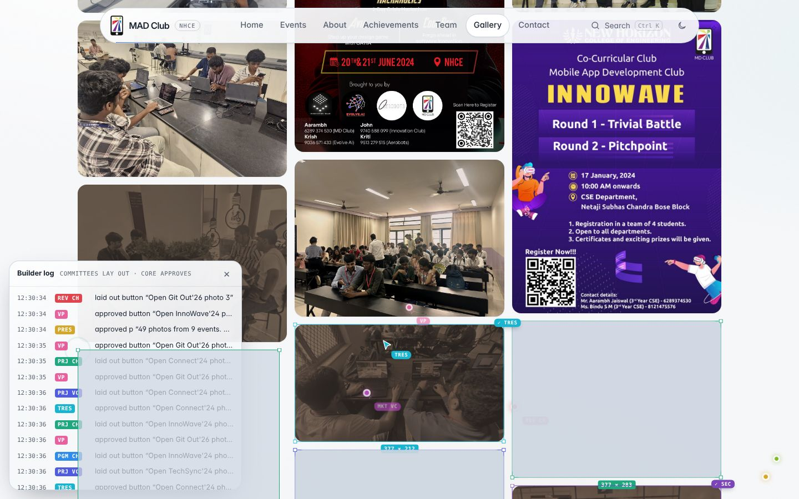

---

## The phone

### Built from the website's own tabs

Press **Build the phone** and particles leave the site's navigation tabs (Home, Events, Gallery, Team...).

1. **The frame.** The chassis forms first.
2. **The flood.** The whole screen fills with an evenly spaced field of particles, rippling down from the top.
3. **The highlights.** The interface is traced over the flood in brighter blue and teal particles.
4. **The builders.** They return and click the regions in, ride the scan line down as the glass body materialises, then tighten the island, buttons and corners.

<p>
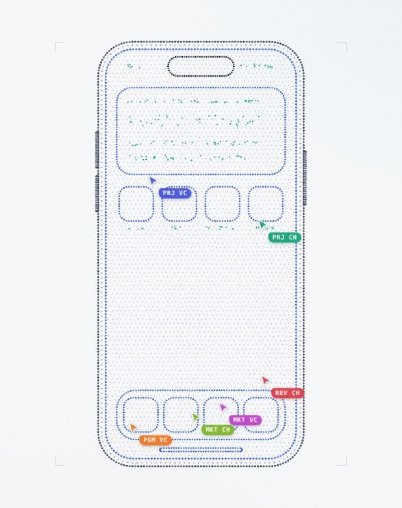
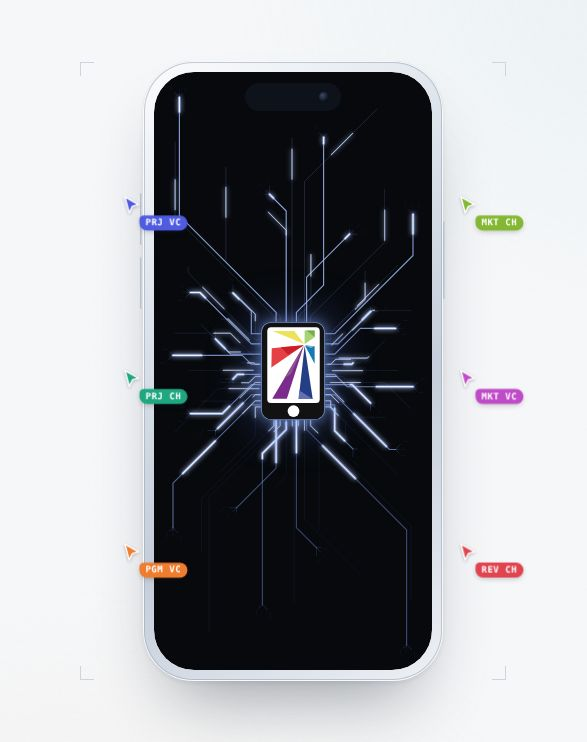
</p>

### Powered by the club logo

The club logo flies from the navigation into the exact centre of the screen. Its phone-shaped outline is traced, and circuits leave its edges like the pins of a chip. A glow flows to every part of the screen and the phone boots.

### MAD OS

The phone boots into a working operating system. The builders construct the lock screen, then the home screen. The logo flies into the dock, becomes the MAD app icon, and a builder taps it to open it.

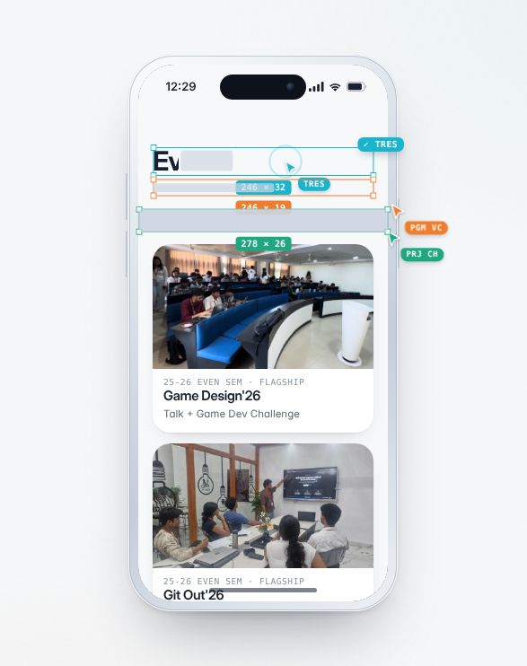

- **Apps:** MAD (events feed, event pages, photo strips), Gallery, Team, About, Join and Settings.
- **Built like a page:** every screen, app, opened event, filtered list and scrolled section is built by the builders.
- **Gestures:** tap the home bar to go home, swipe from the left edge to go back, and tap photos to view them full screen.
- **Settings controls the website:** dark mode, animations, lite effects, builder sounds, replaying the site build, rebuilding the phone and full screen. Each switch confirms itself with a notification on the phone. A hint under the Build control points visitors to it.
- **Full screen:** turns the visitor's own screen into the phone.

---

## The team, as holograms

Each builder flies to the card of the person who holds its role and splits into four projector nodes, one at each corner (44 in total). Together they project the card as a hologram in that builder's colour: light cones, a scan line, and a dense particle tracing of the photo, the background and the text. It then resolves into the real portrait. The President's card is projected in gold, the Secretary's in satin violet, and every other card in its own colour.

<p>
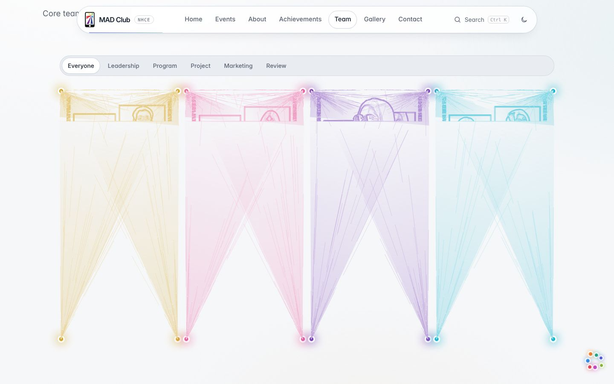
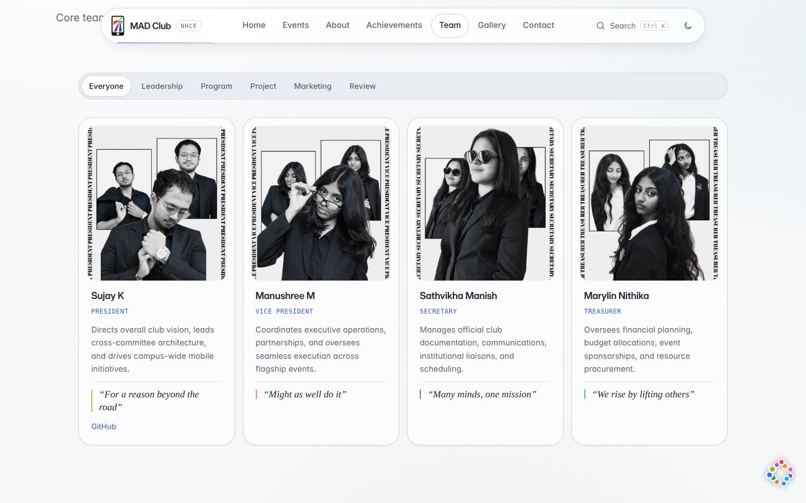
</p>

Every card is the same size, with a head-to-waist portrait. Under each role sits that member's own quote from their poster, with a bar in their colour.

---

## Events

### Documented events and the early years

Events backed by the club's own reports have full posters, dates, venues, participant counts, rounds and faculty coordinators. The early years sit in a compact archive timeline with their rounds and links to their photos. Nothing on the site is a claim that the reports do not support.

<p>
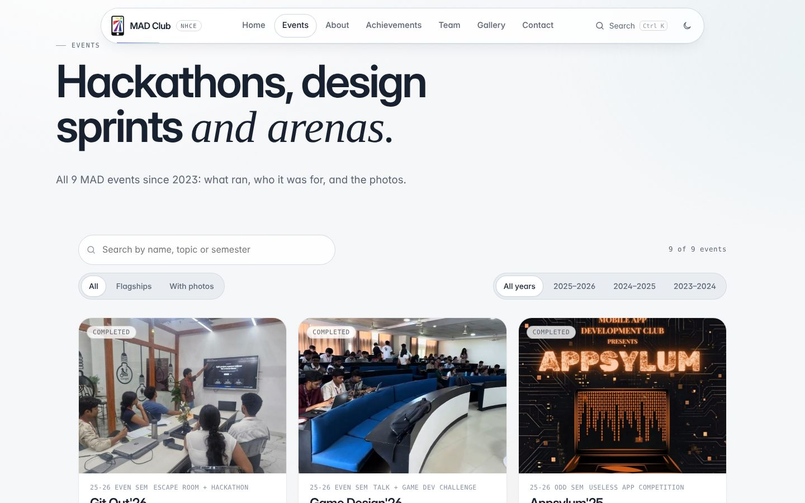
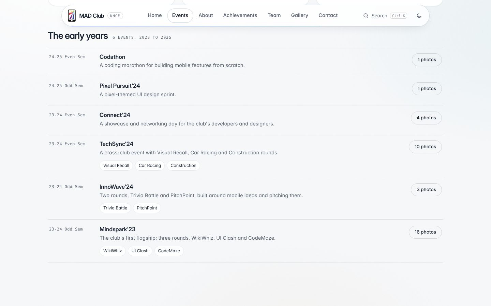
</p>

### Event pages

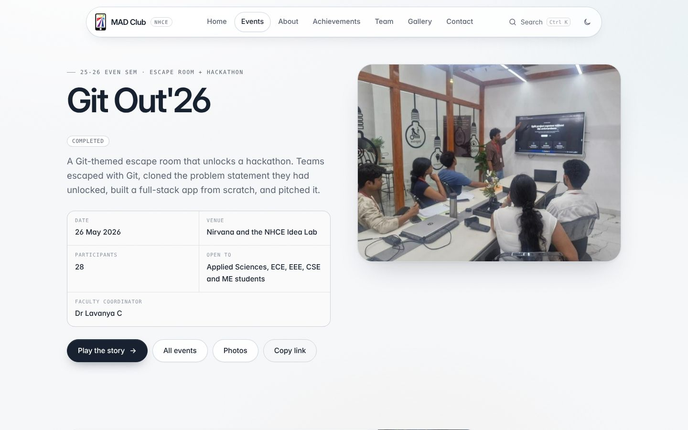

- **Event pass:** a ticket with the event's facts, its code and a barcode drawn from its name. It tilts toward the pointer with a moving sheen.
- **Play the story:** the event as an Instagram-style story. You tap through the title, each round and every photo. Tap the right side for next and the left side for back, hold to pause, and swipe down or press Esc to close.
- **The genre bowl (Game Design'26):** tap the glass bowl to draw a genre chit, Arcade, Puzzle or Racing, just as the participants did.

<p>
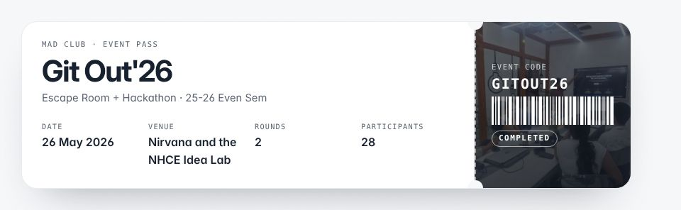
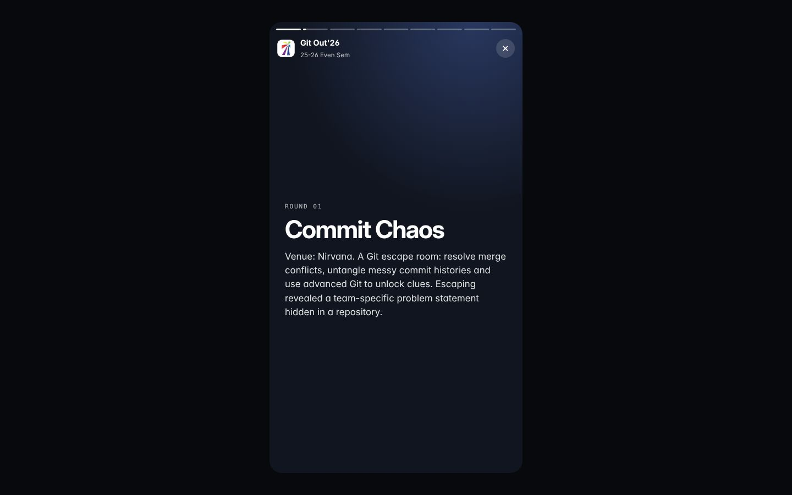
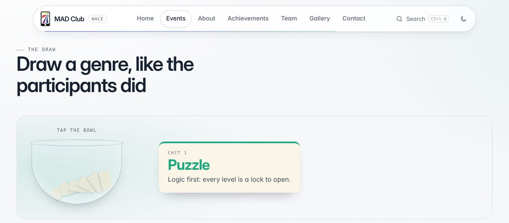
</p>

---

## Gallery

There are 49 photos from 9 events in a filterable mosaic, with a full-screen viewer that supports arrow keys and swipes. **Darkroom:** every photo waits as a red-lit negative and develops once a builder has built it.

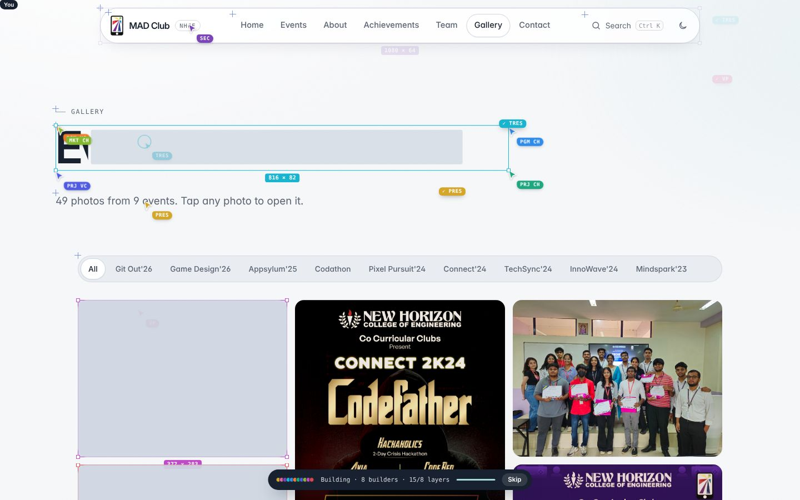

---

## Details

<p>
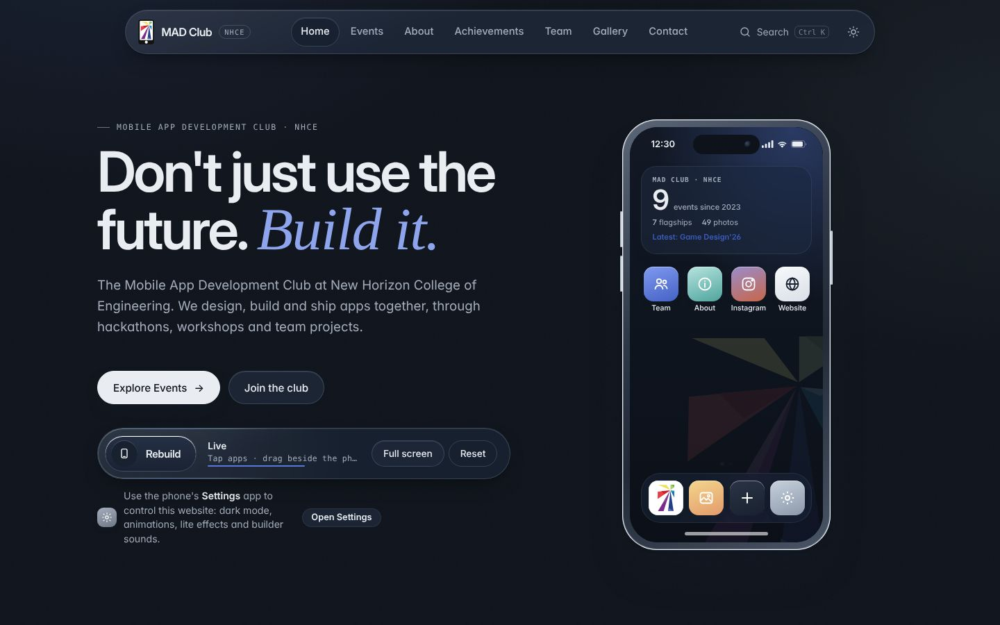
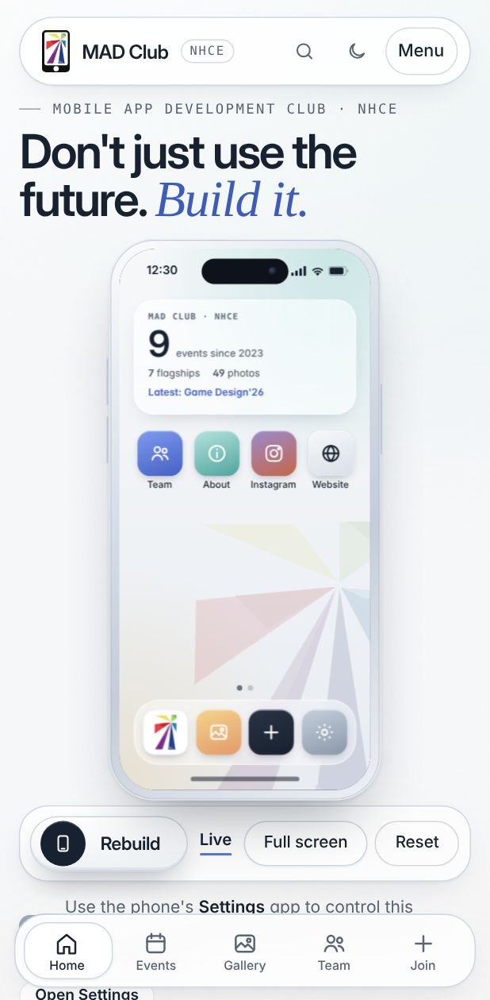
</p>

- **Phone-first home:** on phones, the headline, the phone and its Build control fit on the first screen.
- **Dark mode:** the moon button, or the phone's Settings. It uses a circular reveal from wherever you pressed.
- **Returning visitors:** anyone back within a week skips the intro and gets a quick one-pass build.
- **Lite effects:** fewer particles, no glow filters and solid panels instead of frosted glass. It turns on automatically when a device is slow, or can be chosen in Settings or Ctrl K.
- **Builder sounds:** a soft synthesised click per builder, at its own pitch. Off by default.
- **Reduced motion:** honoured by default, with a one-tap way back in. `?still` in the address shows the finished pages.
- **Lost builders (404):** five builders search an empty grid with flashlights for the missing page.
- **Recruitment mode:** one switch in `content/site.json` adds a badge to the phone's Join app, a notification on the lock screen and a dot on the Join tab.
- **Link previews:** every page has its own 1200×630 share image for WhatsApp, LinkedIn and search. Each HTML file also carries the page's content for visitors without JavaScript.
- **Command menu:** Ctrl K, or the search button, opens pages, events, builder log, lite effects, sounds and replay.
- **Inspect mode:** press **I** and hover anything to see its size, type and colour.
- **Slow motion:** hold **Shift** to watch any animation at 0.18× speed.
- **Developer HUD:** Ctrl Shift D shows the frame rate, build state and swarm timing.
- **Accessibility:** content waiting to be built cannot be tapped or focused, the keyboard works everywhere, focus is managed on page changes, and controls carry proper labels.

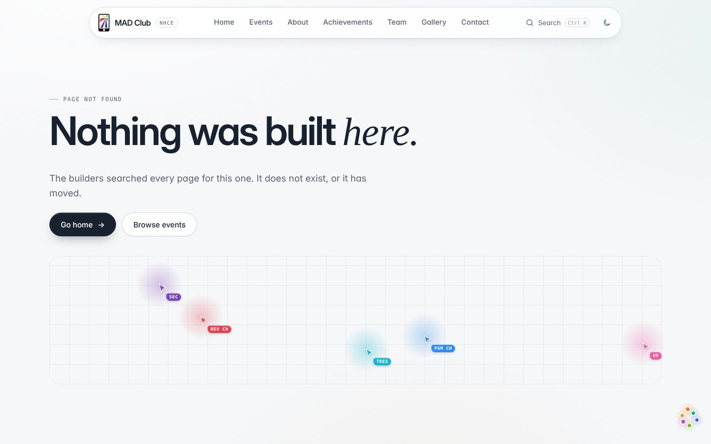

---

## How to see each feature

| Feature | Where |
|---|---|
| Assigning builders intro | First visit, or add `?intro` to any address |
| Role builders and approvals | Any page as it builds (hold **Shift** to slow it down) |
| Builder log | **Ctrl K** (or the search button) → *Builder log* |
| Particle phone and MAD OS | Home → **Build the phone** |
| Phone settings controlling the site | After the build: **Open Settings** under Build, or the Settings app |
| Full-screen phone | Phone Settings → *Full screen* |
| Team holograms and quotes | Team page |
| Event pass and story | Events → Git Out'26, Game Design'26 or Appsylum'25 |
| Genre bowl | Events → Game Design'26, below the rounds |
| Early years archive | Events page, below the posters |
| Darkroom | Gallery |
| Lite effects and builder sounds | Phone Settings, or **Ctrl K** |
| Lost builders | Any address that does not exist, such as `/hello.html` |
| Recruitment mode | Set `recruitment.open` to `true` in `content/site.json` |
| Link previews | Paste a page link into WhatsApp or LinkedIn |

---

## Editing the content

Everything visitors read lives in `content/` and `photos/`:

| File | What it holds |
|---|---|
| `content/site.json` | Club details, hero copy, stats, the five event stages (Discover → Ship), about page, contact, recruitment switch |
| `content/events.json` | Every event: name, semester, date, venue, participants, rounds, judging, genres, photos, Instagram post |
| `content/team.json` | The core team: name, role, committee, portrait, quote, and `holo_node` (which builder projects the card) |
| `content/achievements.json` | Stats, member projects, milestones |
| `photos/` | Event photos (`photos/<event-slug>/`) and team portraits (`photos/team/`) |

After changing content:

```bash
npm run check    # validates every content file
npm run static   # refreshes the share images and the HTML copies used by link previews
```

### Two editors

- **Testing editor at `/admin/`** (login `admin` / `admin`): visual forms with a live preview. Edits are drafts saved in your own browser only. Press **Download JSON** and replace the file in `content/` to publish them.
- **Publishing editor at `/admin/cms/`** (Decap CMS, GitHub login): press **Publish** and it commits to this repository. It needs an OAuth provider: Netlify, or an OAuth proxy set as `base_url` in `admin/cms/config.yml`. For local editing with no login, run `npx decap-server` alongside the site.

---

## Running and deploying

```bash
npm start        # serves the site at http://localhost:4173
```

Open it through the server, not by double-clicking `index.html`, so the browser can read `content/`.

**Deploying:** the included workflow (`.github/workflows/pages.yml`) publishes the site with GitHub Pages. Turn it on once: **Settings → Pages → Source: GitHub Actions**. The site then lives at `https://sk101-art.github.io/md_v1/` and redeploys on every push to `main`.

---

## Code layout

No build step: plain ES modules and CSS served as static files. GSAP is vendored in `assets/gsap.min.js`.

```
assets/design/       tokens, base, components, pages, motion and phone-OS styles
assets/core/         entry point, router, shell (nav, Ctrl K, builder log), content loader, utilities
assets/motion/       swarm director, builders and roles, crew and intro, container tracer, transitions, sound
assets/graphics/     particle field, geometry sampling, power circuits
assets/experiences/  phone builder, MAD OS, full-screen phone, hologram projector
assets/pages/        one module per page (render + wire), event features (pass, story, genre bowl)
assets/brand/        club logo, app icon, rays
assets/og/           share images, one per page
content/             site, events, team and achievements JSON
photos/              event photos and team portraits
admin/               testing editor and Decap CMS
scripts/             local server, content check, static publishing pass
docs/screenshots/    the images in this README
```

---

Built for the MAD Club, NHCE, 2026–27.
